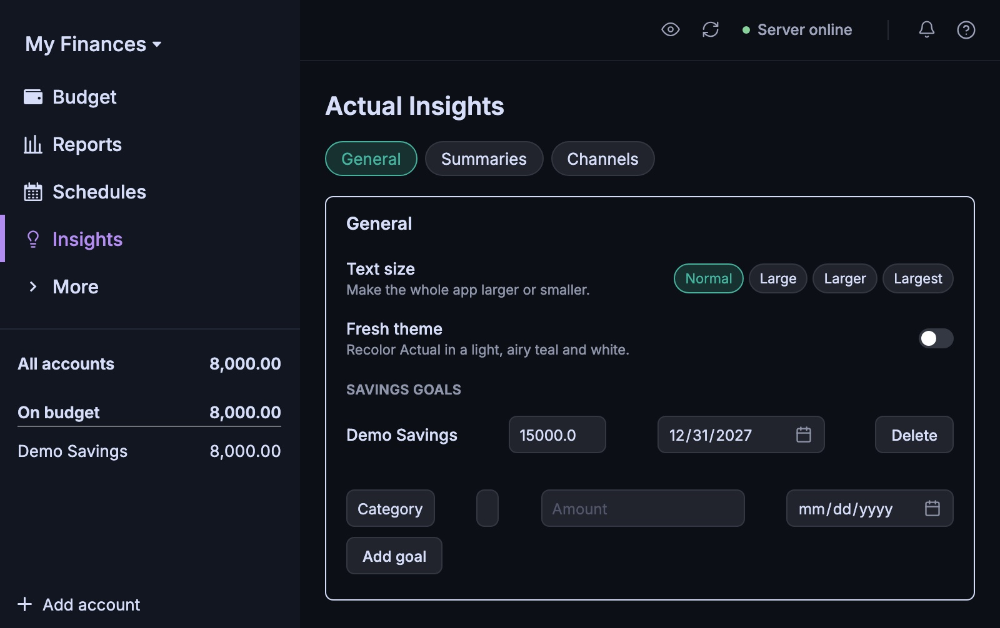
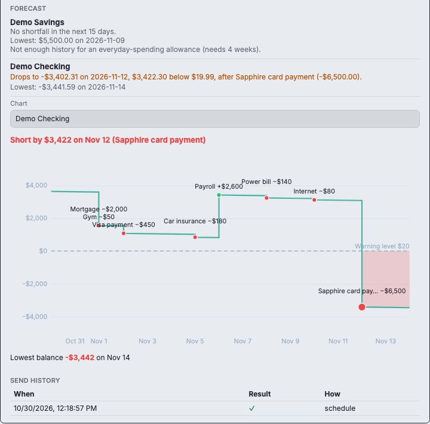

# Actual Insights

> **Built with Claude.** Actual Insights was written largely with
> [Claude](https://claude.com/claude-code), Anthropic's AI coding assistant.
> A human guided the design throughout, reviewed the changes, and verified
> the results against a real budget along the way.

> **Formerly ActualMint.** The project was renamed to Actual Insights. Older
> setups keep working: `{{ACTUALMINT:...}}` placeholders still mount,
> `ACTUALMINT_*` environment variables are still read, and text-size and theme
> choices saved under the old name carry over.

Actual Insights adds a layer of charts and budgeting insights on top of a self-hosted
[Actual Budget](https://actualbudget.org) instance:

- **Charts:** a set of interactive charts, including cash-flow Sankey,
  treemap, spending calendar, burn rate, savings-rate gauge, goal
  thermometers, goal-aware balance history, and a bill radar.
- **Budget tools:** budget-pacing widgets, a projected month-end net,
  paycheck alerts, and a bills timeline.
- **An Insights page** in Actual's sidebar: an optional "Fresh" color theme,
  a global text-size control, savings goals, budget summaries, a cash-flow
  forecast that warns before an account runs low, and notification channels
  to send them through.

All of it is injected into Actual's own Reports page and native UI, with zero
changes to Actual itself.

## How

Actual Budget's own Reports page supports a "Text widget" that renders plain
markdown. Actual Insights hijacks that mechanism: drop in a small placeholder
string (`{{INSIGHTS:spending-sankey:null}}`) and a live, data-backed widget
mounts in its place. A reverse proxy sits in front of Actual and injects one
`<script>`/`<link>` pair into every page it serves, so the whole thing is a
pure add-on: no fork of Actual, no patched client, nothing to rebase when
Actual ships a new release.

## Graph types

Every chart below is added the same way. Open the **Widget builder** on any
Reports page, pick the chart, then paste the placeholder it generates into a
new Actual "Text widget" (see [Adding a widget](#adding-a-widget-to-a-reports-page)).
The placeholder for each chart is listed with it.

The screenshots use made-up demo data.

### Monthly cash-flow Sankey

`{{INSIGHTS:spending-sankey:null}}`


Where this month's money came from and where it went, in one picture. It
reads left to right:

1. Your income sources (paychecks, interest, …).
2. Total income.
3. What you **saved**, plus each spending group.
4. The categories inside each group.

Every band is drawn to scale. Every node shows its dollar amount and its
share of income. If you spent more than you earned, a gray **From savings**
source appears on the left instead of a Saved node.

Click any category to break it out into the merchants you paid. Click it
again to fold it back up.

### Spending treemap

`{{INSIGHTS:spending-treemap:null}}`


This month's spending as nested rectangles, each sized by how much went to
that group. Click a group to zoom into its categories (colored to match the
group), and use the breadcrumb to zoom back out. It's good for spotting the
biggest buckets at a glance.

### Spending calendar

`{{INSIGHTS:spending-heatmap:"month"}}` or `{{INSIGHTS:spending-heatmap:"year"}}`

| Month view | Click a day |
| --- | --- |
|  |  |

**Month view.** A real calendar of daily spending. Each day shows its total,
and the color says how heavy a day it was relative to your own typical days:

- Green means nothing was spent.
- Pale yellow through red cover the quarters of your spending days.
- The legend spells out the dollar range for each color.

Arrows step back through earlier months, and the header shows the month's
total.

**Year view** (`"year"`). Twelve small calendars, each with its monthly
total, for seeing seasonal patterns:


**Click any day** to open a drill-down donut for that single day. It goes
from groups to categories, then merchants, then the individual transactions.

### Spending breakdown donut

`{{INSIGHTS:spending-breakdown-donut:[]}}`


This month's spending by group. Hover a slice to see its name and amount in
the center, and click it to drill into categories, then merchants, then
transactions.
Pass a list of group ids to limit it to just those groups, for example
`["groupId1","groupId2"]`.

### Burn rate

`{{INSIGHTS:burn-rate:null}}`


Cumulative spending through the month, plotted against a straight dashed
"on pace" line from $0 to your total budget. Above the line means you're
spending faster than the budget allows; below it means you're ahead. The
footer shows spent versus budgeted so far.

### Net savings rate gauge

`{{INSIGHTS:savings-rate-gauge:[]}}`


The share of this month's income you didn't spend:

`(income − spending + money moved to savings groups) ÷ income`

Red means negative (you spent more than you earned), amber 0–20%, and green
20% or more.

Some spending is really saving, like brokerage or 529 contributions. List
those category groups in the placeholder (`["groupId"]`, or tick them in the
widget builder) and they're added back as savings instead of counted as
spending.

### Sinking-fund goal thermometers

`{{INSIGHTS:savings-goals-thermometers:[]}}`


One bar per savings goal on a budget category (Christmas, vacation, next
car, …). Each shows the category's current balance against its target, the
target date, and the days left. Goals are set on the Insights page
(see [Savings goals](#savings-goals)). Pass category ids to show only some of
them.

### Account balances with a goal corridor

`{{INSIGHTS:account-balances:[]}}`, or
`{{INSIGHTS:account-balances:{"accountIds":[],"labelContent":"amount"}}}`


A stacked-area history of your account balances. There's a **Combined**
view, and a **Separate** view with one chart per account. Ranges are 1M, 3M,
6M, 1Y, and All.

When an account has a savings goal, like a kid's 529 with a target by
graduation, the 1Y and All views extend the timeline to the goal's target
date. A dashed line shows the path needed to reach it. `labelContent` picks
what each band's label shows: `"both"` (the default), `"amount"`, or
`"name"`.

### Subscription & bill radar

`{{INSIGHTS:subscription-radar:null}}`


Every scheduled transaction in the next 30 days, laid out on a timeline:

- **Labels:** each one goes in the nearest free row above or below the line,
  so none ever overlap. Dots for the same day stack.
- **Amounts:** deposits show a green **+**.
- **Colors:** dots are colored by category group. Gray means the schedule has
  no category, which is common for credit-card payments since Actual treats
  them as transfers.

It reads straight from Actual's Schedules.

### How the charts count income and spending

The charts share one set of rules, so the Sankey, gauge, calendar, and
treemap always agree with each other:

- **Transfers:** moves between your own accounts never count as income or
  spending. That covers linked transfers, and also a category group named
  **Transfers**, for money moved between accounts but categorized rather
  than linked.
- **Income:** Actual's own income group counts, plus any category group with
  "Income" in its name, for budgets that keep paychecks in a regular group.
- **Starting balances:** opening balances from adding an account never count
  as income.
- **Refunds:** a category whose refunds outweigh its spending for the period
  is left out rather than drawn as negative spending.

## The Insights page

An **Insights** entry in Actual's sidebar, just below Schedules, opens Actual
Insights' own page. It works with Actual's own sidebar and with Actual Budget
Tweaks' "Live sidebar", in both its Standard and Split layouts. The page has
four tabs:

- **General:** text size, the Fresh theme, and savings goals.
- **Summaries:** scheduled and on-demand budget summaries (see
  [Budget summaries](#budget-summaries)).
- **Channels:** the places notifications can go (see
  [Notification channels](#notification-channels)).
- **Forecast:** a daily check that warns before a watched account's balance
  runs low (see [Cash-flow forecast](#cash-flow-forecast)).

The page lives in the URL hash (`#actual-insights`, or
`#actual-insights/summaries`) on whichever Actual page you were on, so a
refresh or a bookmark brings you back to it. Actual keeps that page loaded
underneath, and any sidebar item takes you back to it. Actual's Settings
page keeps a small "Actual Insights" card with an **Open Insights** button,
for anyone who remembers where these settings used to be.



## Notification channels

The **Channels** tab holds an app-wide list of places Actual Insights can
send things. Features that send messages pick a channel from this one list
rather than each asking for their own settings. Every channel has a
**Send test** button that sends a short test message and shows the result
(or the error) right there.

| Type | What you enter |
| --- | --- |
| ntfy | Server URL, topic, optional access token, priority |
| Email (SMTP) | Host, port, security (STARTTLS / TLS / none), username, password, from, to |
| Webhook | URL, method (POST or PUT), custom headers; sends the full JSON message |
| Discord | Webhook URL |
| Slack | Incoming webhook URL |
| Telegram | Bot token, chat ID |
| Pushover | App token, user key |
| Gotify | Server URL, app token |
| Home Assistant | Base URL, webhook ID (fires an HA webhook trigger) |
| Apprise | Apprise API URL, plus a config key or target URLs |

- **Secrets are write-only.** Passwords, tokens, keys, custom header values,
  and any URL or ID that grants access on its own (Discord/Slack/Home
  Assistant webhooks, Apprise targets, the ntfy topic) can be set or
  replaced in the browser but are never sent back to it. When you edit a
  channel, a stored secret shows as "set": leave it blank to keep it. Error
  text is scrubbed of every stored secret before it is shown or logged.
- **Gmail:** the Email form has a **Gmail** preset that fills in the host,
  port, and security. Gmail needs an app password (Google Account →
  Security → 2-Step Verification → App passwords); your normal password
  won't work.
- **Where they're stored:** channels live in `channels.json` under
  `INSIGHTS_DATA_DIR`, next to `goals.json`. It holds secrets in plain text
  (mode `0600`), so keep that volume private and back it up the same way
  you back up `goals.json`.

Code elsewhere in the API sends through one shared function,
`notify(channelId, message)` in `api/src/notify.js`, with a message of
`{ title, text, markdown?, html?, data? }`; each channel type uses what
fits. A new channel type is one file in `api/src/channels/types/` plus one
line in `api/src/channels/registry.js`.

## Budget summaries

The **Summaries** tab sets up a short report on how the budget is doing,
sent to any channel on a schedule or when you press **Send now**. It opens
with whether spending is on track for this point in the month, then points
at the few things worth a look.

### Sections

One shared set of sections serves every delivery. Each can be turned off,
and a section with nothing to report is left out of that summary.

| Section | What it shows | Settings |
| --- | --- | --- |
| Pacing | Spending against the budget for how far through the month we are, overall and for each budget line that's off track. Same numbers as the Pacing Bars widget: available is `balance + spent`, so carryover counts. A line is off track when spent passes available × the share of the month gone, plus a tolerance. | Tolerance in percent (default 10); optionally only some categories |
| Largest transactions | The biggest spending transactions in the delivery's period | How many (default 5); minimum amount; exclude scheduled payments (default on) |
| Coming up | Bills and credit card payments due soon, from Actual's schedules | Look-ahead in days (default 7); minimum amount |
| Watched categories | Chosen categories, always shown, good or bad | Category list |
| Over budget | Chosen categories, shown only when spending has passed everything available | Category list |

Pacing, watched, and over-budget categories always measure the current
month to date (Actual budgets by calendar month), even on the 1st. The
delivery's period applies to Largest transactions, which can span two
months.

### Exclusions

Summaries count spending the way the charts do: transfers, starting
balances, and income groups are never spending. On top of that, **Exclude
from updates** removes chosen categories, payees, and schedules from every
section, for things you expect and don't need to hear about (the mortgage,
say). A watched or over-budget category still shows even if it's also
excluded; the tab notes when that's the case.

### Deliveries

A delivery is a name, a channel, a period, and a schedule. Each one has
**Preview** (shows the text, markdown, HTML, and JSON exactly as they'd go
out, without sending) and **Send now**.

| Period | Covers |
| --- | --- |
| Yesterday | The previous calendar day |
| Week in Review | The 7 days ending yesterday |
| New Since Last Summary | Transactions this delivery hasn't reported before, by transaction id rather than date, so a bank import that lands days late is still reported, once. The first send covers the last 7 days. |
| Month-to-date, highlighting This Week | The month so far, with items from the last 7 days flagged |

- **Schedules** are days of the week plus one or more times. Daily means
  all seven days; no days or times means send on demand only.
- **Time zone:** schedules fire in the API's `TZ`. The tab shows that zone
  and warns when your browser's is different.
- **Missed sends:** if the API was down at send time, it sends once on
  startup when the miss is under 12 hours old, and skips it otherwise.
  Never more than one catch-up per delivery.
- **Failures:** a failed send is retried twice (after 2 and then 6
  minutes). If it still fails, one alert goes to the channel chosen under
  **Alert me about failures on**, naming the delivery and the error.
  Every outcome lands in **Send history** (the last 100), even when the
  alert channel is the broken one. History keeps the outcome and the
  scrubbed error only, never message bodies or secrets.

### Webhook payload

Webhook and Home Assistant channels receive the message's `data`: a
versioned, stable JSON summary for agents and automations. Amounts are
integer cents; spending is positive. Keys may be added in later versions,
never renamed or removed without bumping `schemaVersion`.

```json
{
  "schemaVersion": 1,
  "generatedAt": "2026-10-29T13:00:00.000Z",
  "delivery": { "id": "9b0c…", "name": "Week in Review", "period": "week" },
  "period": { "start": "2026-10-22", "end": "2026-10-28" },
  "month": "2026-10",
  "text": "Week in Review: 2026-10-22 to 2026-10-28\n\nPacing\n- On track: $812.00 spent, $890.00 expected by today\n…",
  "sections": {
    "pacing": {
      "title": "Pacing",
      "data": {
        "overall": { "spentCents": 81200, "availableCents": 98500, "expectedCents": 89000, "status": "on-pace", "fractionElapsed": 0.935 },
        "offTrack": [
          { "categoryId": "…", "name": "Dining", "groupName": "Food", "spentCents": 21000, "availableCents": 20000, "expectedCents": 18700, "status": "over" }
        ],
        "groups": [{ "groupName": "Food", "spentCents": 61000, "availableCents": 80000 }]
      }
    },
    "largest": {
      "title": "Largest transactions",
      "data": { "items": [{ "id": "…", "date": "2026-10-27", "payee": "Grocer", "categoryName": "Groceries", "accountName": "Visa", "amountCents": 14520, "inHighlight": false }] }
    },
    "upcoming": {
      "title": "Coming up",
      "data": { "items": [{ "scheduleId": "…", "name": "Visa payment", "date": "2026-11-02", "amountCents": 123456, "accountName": "Checking" }], "totalCents": 123456 }
    },
    "watched": {
      "title": "Watched categories",
      "data": { "categories": [{ "categoryId": "…", "name": "Groceries", "spentCents": 40000, "availableCents": 60000, "remainingCents": 20000, "status": "on-pace" }] }
    },
    "alerts": {
      "title": "Over budget",
      "data": { "categories": [{ "categoryId": "…", "name": "Dining", "spentCents": 21000, "availableCents": 20000, "remainingCents": -1000, "status": "over" }] }
    }
  }
}
```

Statuses are `under`, `on-pace`, `off-track`, and `over`. A section that
fails to build appears as `{ "title", "data": null, "error": "could not be
built" }` while the rest of the summary still goes out.

### Where it's stored

`summary-settings.json` (sections, exclusions, deliveries, failure channel)
and `summary-history.json` (send history and the transaction ids each New
Since Last Summary delivery has reported, kept 90 days) live in the data
volume under `INSIGHTS_DATA_DIR`, next to `goals.json` and `channels.json`.
Neither holds secrets.

A new section is one file in `api/src/summary/sections/`, one line in its
`index.js`, and its defaults in `api/src/summary/settings-store.js`.

## Cash-flow forecast

The **Forecast** tab projects a checking account's balance forward a couple
of weeks and warns you, through any channel, before it would drop below a
level you set. It answers one question ("will this account cover what's
coming out?") and states what it found; it doesn't suggest what to do.

### What it counts

For each account you switch on, starting from today's balance, day by day
through the look-ahead window (default 15 days, 1 to 30):

| Counted | How |
| --- | --- |
| Scheduled bills and income | Every occurrence of Actual's schedules on that account in the window, at the schedule's amount. An occurrence that already posted is skipped; an overdue one that hasn't posted is counted today. |
| Credit-card payments | Whatever amount the payment schedule holds (in our setup, what cc-helper wrote there). The forecast never estimates a card payment itself, so past the window cc-helper has filled in (15 days) later card payments may be missing; the tab says so when the window is longer than 15 days. |
| Everyday spending | A daily allowance: the **median** weekly spending over the last 8 complete weeks, divided by 7. The median keeps one big purchase from inflating it. It leaves out income, transfers, starting balances and adjustments, and payees that already have a schedule on the account (so a bill isn't counted twice). With under 4 weeks of history the allowance is zero, and the forecast says so. |

Only open, on-budget accounts can be switched on. Each has its own
**warning level** (default $0): the forecast flags the first day the
projected balance goes below it, how far below (the shortfall), the largest
outflow that day, and the lowest balance in the window.

### Check now and the chart

**Check now** computes the forecast from your saved settings and shows it
without sending anything or touching the send history. For each account it
shows the first shortfall (or "No shortfall in the next N days") and the
lowest balance, plus a chart: the projected balance, a dashed line at the
warning level, the part below it shaded red, and the scheduled items
labelled on their dates. With more than one account switched on, a picker
chooses which account the chart shows.



### The daily check

Turn on **Check every day**, pick a channel and a time, and the API runs the
check once a day in its `TZ`.

- **Only new or changed shortfalls are sent.** A shortfall that persists
  doesn't re-send every day. It sends again only when its first date moves,
  or when the shortfall changes by more than the greater of $25 or 5% of the
  shortfall in the last warning sent (compared with the last one *sent*, so
  slow drift adds up). When an account recovers nothing is sent, and its next
  shortfall counts as new.
- **One message per day at most,** covering every account that is new or
  changed. There is no all-clear message.
- **Missed checks:** like summaries, a check missed while the API was down
  runs once on startup when the miss is under 12 hours old.
- **Failures:** a failed send is retried twice (after 2 and then 6 minutes).
  If it still fails, or an account can't be computed, one alert goes to the
  failure channel chosen on the **Summaries** tab (**Alert me about failures
  on**). The warning state only advances for a warning that was actually
  sent, so a failed one is tried again the next day.
- **Send test message** sends one short test message to the saved channel
  (no retries) and shows the result.
- **Send history** lists the last 50 checks: when, the outcome, and whether
  it was the schedule or a catch-up.

### Warning payload

Webhook and Home Assistant channels receive the message's `data`. As with
summaries, amounts are integer cents, dates are `YYYY-MM-DD`, and keys are
only ever added. `item` is the largest outflow on the first day below the
level (`null` when everyday spending alone crosses it), with its amount
signed the way Actual stores it (outflows negative).

```json
{
  "schemaVersion": 1,
  "event": "cash-flow-warning",
  "generatedAt": "2026-10-30T13:00:00.000Z",
  "windowDays": 15,
  "accounts": [
    {
      "accountId": "…",
      "accountName": "Checking",
      "warningLevelCents": 50000,
      "firstDate": "2026-11-13",
      "shortfallCents": 82000,
      "lowestCents": -38500,
      "lowestDate": "2026-11-14",
      "item": { "name": "Visa payment", "amountCents": -240000 },
      "allowancePerDayCents": 6500
    }
  ]
}
```

The test message sends `{ "schemaVersion": 1, "event": "cash-flow-test" }`
and a failure alert `{ "schemaVersion": 1, "event":
"cash-flow-check-failed", "error": "…" }`.

### Where it's stored

`forecast-settings.json` (the daily check, channel, time, window, and each
account's switch and warning level) and `forecast-history.json` (the check
history and what the last warning said for each account) live under
`INSIGHTS_DATA_DIR`, next to the summary files. Neither holds secrets.

The tab talks to `/api/forecast/settings` (GET/PUT), `/api/forecast/check`
(POST, compute only), `/api/forecast/test` (POST) and
`/api/forecast/history` (GET).

## Savings goals

The two goal-based charts (the thermometers and the balance-history goal
line) read from **savings goals** you set on the **Insights** page's General
tab (see [The Insights page](#the-insights-page)):

- **What a goal tracks:** either a budget category (a sinking fund) or an
  account (for example, a 529).
- **What a goal includes:** a target amount and a target date.
- **Where goals are stored:** in `goals.json` under
  `INSIGHTS_DATA_DIR`. Mount a volume there; see
  [Configuration](#configuration).

## Other features

- **Budget pacing bars:** spent versus budgeted for any set of categories
  this month, at a glance. Click a bar to drill into categories, then payees,
  then transactions.
- **Projected month-end net:** where this month's balance is headed if the
  current pace holds.
- **Paycheck alerts:** flags 3-paycheck months for whichever pay cadence
  your income already shows. The cadence is detected, not hard-coded to
  biweekly.
- **Bills / autopay timeline:** a list of upcoming scheduled payments, with
  Actual's own Schedules as the source of truth.
- **Unlinked transfers:** pairs of matching inflows and outflows between
  your accounts that were never linked as a transfer. These double-count as
  income and spending until you link them.
- **Widget builder:** generates the exact placeholder string for any widget.
  Pick the type, check off categories, accounts, or groups, and copy the
  result, so you never hand-write one. It lives next to Actual's own "Add new
  widget" button on the Reports toolbar.
- **Fresh theme:** a one-click re-skin of Actual's own color palette
  (Budget, Transactions, and Reports alike) into a light, airy teal-and-white
  look.
  - **Where it's set:** from the Insights page's General tab, saved per
    browser.
  - **Tip:** pick Actual's own **Light** theme first, since the recolor
    assumes a light background.
- **Global text-size control:** set from the same General tab. It scales
  the *entire* app (budget tables, transaction registers, reports,
  schedules), not just Actual Insights' widgets. It's saved per browser.

| Pacing bars and drill-down | Reports widgets |
| --- | --- |
|  |  |

| Widget builder | Settings |
| --- | --- |
|  |  |

| Text size control |
| --- |
|  |

## Architecture

```
browser --(HTTPS)--> insights-proxy --> abt/actual (Actual's own server)
                           |
                           `--(/api/*)--> insights-api --> actual (direct)
```

- **`proxy/`** (`insights-proxy`): a reverse proxy in front of Actual, or
  in front of an [Actual Budget Tweaks](https://github.com/aelxxs/actual-budget-tweaks)
  sidecar if you run one. It passes everything through unchanged, except
  that it:
  - injects the bundle's `<script>`/`<link>` tags into HTML responses,
  - serves the bundle's static files,
  - proxies `/api/*` to `insights-api`.
- **`api/`** (`insights-api`): a small Express API backed by a single
  long-running [`@actual-app/api`](https://actualbudget.org/docs/api/)
  client connection. It's read-only, except for savings goals. Every request
  is validated against Actual's own session token, the same mechanism
  Actual's web client uses, so there's no separate login or credential to
  manage.
- **`bundle/`**: the browser-side code. That's the Svelte 5 + D3 widgets, the
  widget registry and builder panel, the Insights page and its sidebar
  entry, the Settings-page card, and the mount logic that scans the page for
  `{{INSIGHTS:...}}` placeholders.

## Configuration

### `insights-proxy`

| Env var | Default | Purpose |
| --- | --- | --- |
| `ABT_ORIGIN` | `http://abt:3005` | Upstream origin to proxy to (Actual, or an ABT sidecar in front of it) |
| `INSIGHTS_API_ORIGIN` | `http://insights-api:3011` | Where `/api/*` requests are forwarded |
| `PORT` | `3010` | Port the proxy listens on |
| `INSIGHTS_BUNDLE_PATH` | `/insights` | URL path prefix the bundle is served under |
| `STATIC_DIR` | `./static` | Filesystem directory served under `INSIGHTS_BUNDLE_PATH` (the bundle's build output) |

### `insights-api`

| Env var | Purpose |
| --- | --- |
| `ACTUAL_SERVER_URL` | Your Actual server's own URL, e.g. `http://actual:5006` |
| `ACTUAL_SERVER_PASSWORD` | Actual's server password |
| `ACTUAL_SYNC_ID` | The budget's sync *group* id (Settings → Advanced Settings → Sync ID in Actual) |
| `ACTUAL_E2E_PASSWORD` | Only needed if the budget has end-to-end encryption enabled |
| `INSIGHTS_DATA_DIR` | Where `goals.json`, `channels.json`, `summary-settings.json`, `summary-history.json`, `forecast-settings.json` and `forecast-history.json` are stored (default `/data`). Mount a writable volume here so they survive container rebuilds; `channels.json` holds secrets, so keep the volume private |
| `PORT` | `3011` by default |
| `TZ` | Set this to your own timezone (required): several widgets do day-of-month math, and budget summary schedules and the daily cash-flow check fire in this zone |

## Development

Each package is independent and has its own test suite:

```sh
cd bundle && npm install && npm test   # Svelte widgets, vitest
cd api && npm install && npm test      # insights-api, jest
cd proxy && npm install && npm test    # insights-proxy, jest
```

The bundle is a Vite build (`cd bundle && npx vite build`) that produces
`dist/bundle.js` and `dist/bundle.css`. `insights-proxy` serves those as a
read-only volume mount, so rebuilding the bundle never requires rebuilding or
restarting the proxy or API containers.

One gotcha for anyone writing new queries: Actual's AQL silently applies only
the **first** operator when a field has two, so `date: { $gte: a, $lte: b }`
means only "on or after `a`". Build date ranges with `dateRange()` in
`api/src/aql-date-range.js`, which uses `$and` instead.

## Adding a widget to a Reports page

1. Open the **Widget builder** panel on any Reports page.
2. Pick a widget type, and fill in any fields (categories, accounts, groups).
3. Click **Generate**.
4. Paste the resulting placeholder into a new Actual "Text widget" on your
   Reports dashboard.

## License

[MIT](LICENSE)
