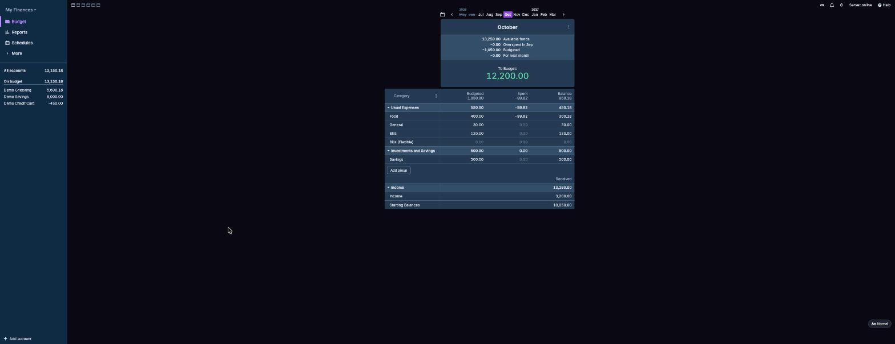
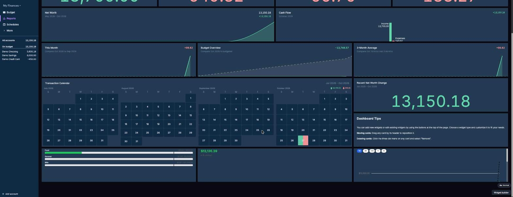
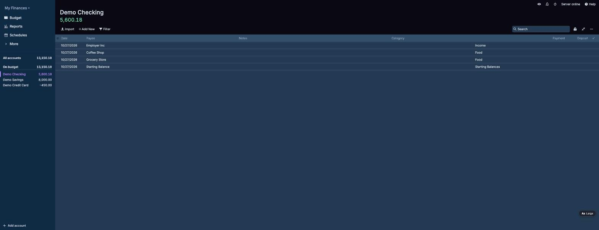
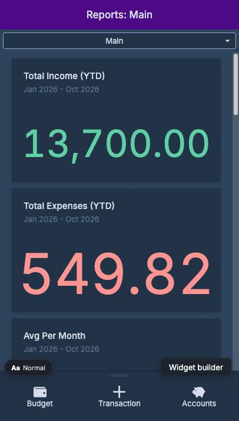

# ActualMint

ActualMint adds a Mint/Simplifi-style layer on top of a self-hosted
[Actual Budget](https://actualbudget.org) instance: at-a-glance budget-pacing
widgets, projected month-end net, paycheck-cadence alerts, a bills/autopay
timeline, account balance history, and a global text-size control — all
injected into Actual's own Reports page and native UI, with zero changes to
Actual itself.



## Why

Actual Budget's own Reports page supports a "Text widget" that renders plain
markdown. ActualMint hijacks that mechanism: drop in a small placeholder
string (`{{ACTUALMINT:pacing-bars:[...]}}`) and a live, data-backed widget
mounts in its place. A reverse proxy sits in front of Actual, injecting one
`<script>`/`<link>` pair into every page it serves, so the whole thing is a
pure add-on — no fork of Actual, no patched client, nothing to rebase when
Actual ships a new release.

## Features

- **Budget pacing bars** — spent vs. budgeted for any set of categories,
  this month, at a glance.
- **Projected month-end net** — where this month's balance is headed if
  current pace holds.
- **Paycheck alerts** — flags 3-paycheck months for whichever pay cadence
  your income already shows (generic cadence detection, not hardcoded to
  biweekly).
- **Bills / autopay timeline** — upcoming scheduled payments, trusting
  Actual's own Schedules as the source of truth.
- **Account balance history** — a chart of one or more accounts' balances
  over a selectable date range.
- **Category/payee drill-down** — click into a pacing bar to see a donut
  breakdown of categories → payees → transactions.
- **Widget builder** — a floating panel (bottom-right on the Reports page)
  that generates the exact placeholder string for any widget above, so you
  never hand-write one.
- **Global text-size control** — a persistent "Aa" control that bumps the
  size of the *entire* app (budget tables, transaction registers, reports,
  schedules — not just ActualMint's own widgets) for a browser/device that
  needs bigger text. Persisted per-browser in `localStorage`.
- Both floating controls reposition themselves above Actual's own mobile
  bottom navigation bar, so neither ever overlaps it.

| Reports widgets | Text size control |
| --- | --- |
|  |  |

| Mobile |
| --- |
|  |

## Architecture

```
browser --(HTTPS)--> actualmint-proxy --> abt/actual (Actual's own server)
                           |
                           `--(/api/*)--> actualmint-api --> actual (direct)
```

- **`proxy/`** — `actualmint-proxy`: a reverse proxy in front of Actual (or
  an [Actual Budget Tweaks](https://github.com/aelxxs/actual-budget-tweaks)
  sidecar, if you run one). Passes everything through unchanged except:
  injects the bundle's `<script>`/`<link>` tags into HTML responses, serves
  the bundle's static files, and proxies `/api/*` to `actualmint-api`.
- **`api/`** — `actualmint-api`: a small read-only Express API backed by a
  single long-running [`@actual-app/api`](https://actualbudget.org/docs/api/)
  client connection. Validates every request against Actual's own session
  token (the same mechanism Actual's web client itself uses), so there's no
  separate login or credential to manage.
- **`bundle/`** — the browser-side code: Svelte 5 widgets, the widget
  registry and builder panel, the text-scale control, and the mount logic
  that scans the page for `{{ACTUALMINT:...}}` placeholders.

## Configuration

### `actualmint-proxy`

| Env var | Default | Purpose |
| --- | --- | --- |
| `ABT_ORIGIN` | `http://abt:3005` | Upstream origin to proxy to (Actual, or an ABT sidecar in front of it) |
| `ACTUALMINT_API_ORIGIN` | `http://actualmint-api:3011` | Where `/api/*` requests are forwarded |
| `PORT` | `3010` | Port the proxy listens on |
| `ACTUALMINT_BUNDLE_PATH` | `/actualmint` | URL path prefix the bundle is served under |
| `STATIC_DIR` | `./static` | Filesystem directory served under `ACTUALMINT_BUNDLE_PATH` (the bundle's build output) |

### `actualmint-api`

| Env var | Purpose |
| --- | --- |
| `ACTUAL_SERVER_URL` | Your Actual server's own URL, e.g. `http://actual:5006` |
| `ACTUAL_SERVER_PASSWORD` | Actual's server password |
| `ACTUAL_SYNC_ID` | The budget's sync *group* id (Settings → Advanced Settings → Sync ID in Actual) |
| `ACTUAL_E2E_PASSWORD` | Only needed if the budget has end-to-end encryption enabled |
| `PORT` | `3011` by default |
| `TZ` | Set this to your own timezone — several widgets do day-of-month math |

## Development

Each package is independent and has its own test suite:

```sh
cd bundle && npm install && npm test   # Svelte widgets, vitest
cd api && npm install && npm test      # actualmint-api, jest
cd proxy && npm install && npm test    # actualmint-proxy, jest
```

The bundle is a Vite build (`cd bundle && npx vite build`) producing
`dist/bundle.js` / `dist/bundle.css`, which `actualmint-proxy` serves as a
read-only volume mount — rebuilding the bundle never requires rebuilding or
restarting the proxy or API containers.

## Adding a widget to a Reports page

Open the **Widget builder** panel (bottom-right on any Reports page), pick a
widget type, fill in any fields (categories, accounts), click **Generate**,
then paste the resulting placeholder into a new Actual "Text widget" on your
Reports dashboard.

## License

[MIT](LICENSE)
