# ActualMint

> **Built with Claude.** ActualMint was written largely with
> [Claude](https://claude.com/claude-code), Anthropic's AI coding assistant.
> A human guided the design throughout, reviewed the changes, and verified
> the results against a real budget along the way.

ActualMint adds a Mint/Simplifi-style layer on top of a self-hosted
[Actual Budget](https://actualbudget.org) instance:

- **Charts:** a set of interactive charts, including cash-flow Sankey,
  treemap, spending calendar, burn rate, savings-rate gauge, goal
  thermometers, goal-aware balance history, and a bill radar.
- **Budget tools:** budget-pacing widgets, a projected month-end net,
  paycheck alerts, and a bills timeline.
- **App-wide settings:** a Mint-style theme and a global text-size control.

All of it is injected into Actual's own Reports page and native UI, with zero
changes to Actual itself.

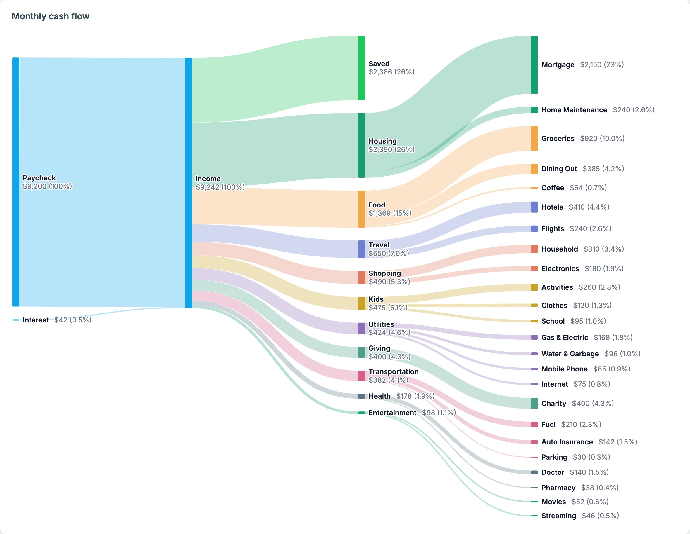

## Why

Actual Budget's own Reports page supports a "Text widget" that renders plain
markdown. ActualMint hijacks that mechanism: drop in a small placeholder
string (`{{ACTUALMINT:spending-sankey:null}}`) and a live, data-backed widget
mounts in its place. A reverse proxy sits in front of Actual and injects one
`<script>`/`<link>` pair into every page it serves, so the whole thing is a
pure add-on: no fork of Actual, no patched client, nothing to rebase when
Actual ships a new release.

## Graph types

Every chart below is added the same way. Open the **Widget builder** on any
Reports page, pick the chart, then paste the placeholder it generates into a
new Actual "Text widget" (see [Adding a widget](#adding-a-widget-to-a-reports-page)).
The placeholder for each chart is listed with it.

The screenshots use made-up demo data.

### Monthly cash-flow Sankey

`{{ACTUALMINT:spending-sankey:null}}`


Where this month's money came from and where it went, in one picture. It
reads left to right:

1. Your income sources (paychecks, interest, …).
2. Total income.
3. What you **saved**, plus each spending group.
4. The categories inside each group.

Every band is drawn to scale. Every node shows its dollar amount and its
share of income. If you spent more than you earned, a gray **From savings**
source appears on the left instead of a Saved node.

Click any category to break it out into the merchants you paid. Click it
again to fold it back up.

### Spending treemap

`{{ACTUALMINT:spending-treemap:null}}`

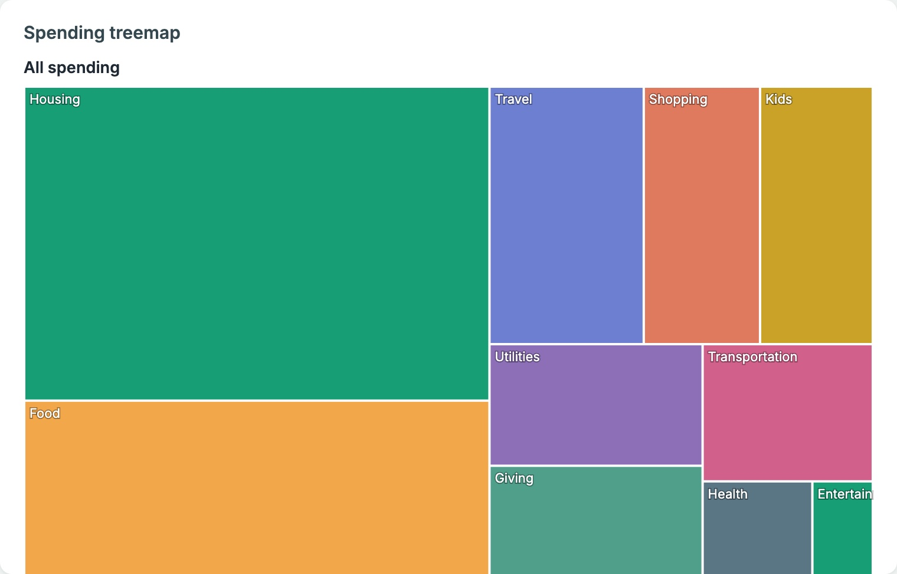

This month's spending as nested rectangles, each sized by how much went to
that group. Click a group to zoom into its categories (colored to match the
group), and use the breadcrumb to zoom back out. It's good for spotting the
biggest buckets at a glance.

### Spending calendar

`{{ACTUALMINT:spending-heatmap:"month"}}` or `{{ACTUALMINT:spending-heatmap:"year"}}`

| Month view | Click a day |
| --- | --- |
| 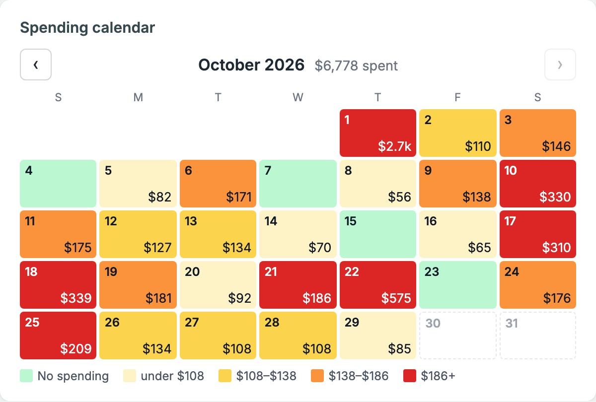 | 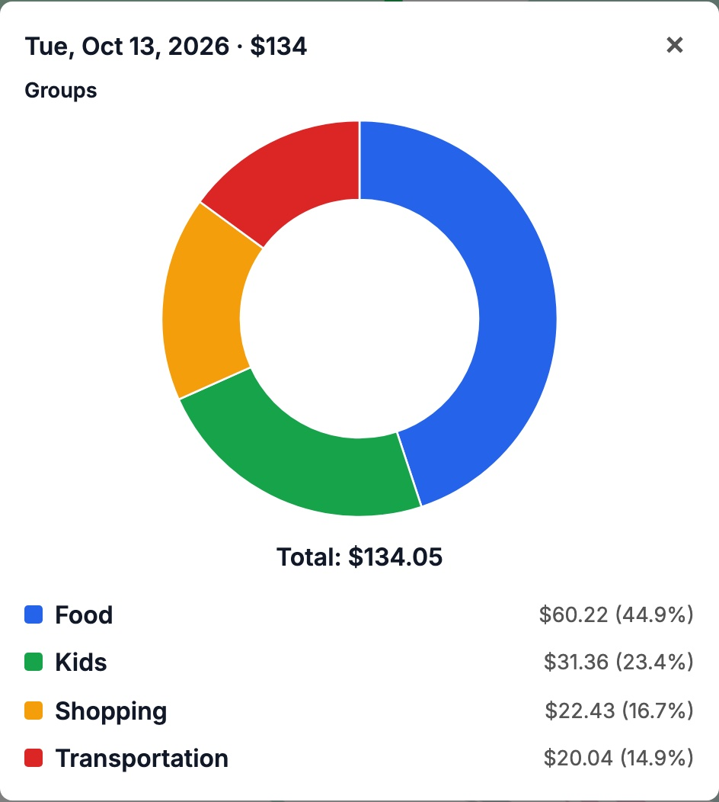 |

**Month view.** A real calendar of daily spending. Each day shows its total,
and the color says how heavy a day it was relative to your own typical days:

- Green means nothing was spent.
- Pale yellow through red cover the quarters of your spending days.
- The legend spells out the dollar range for each color.

Arrows step back through earlier months, and the header shows the month's
total.

**Year view** (`"year"`). Twelve small calendars, each with its monthly
total, for seeing seasonal patterns:

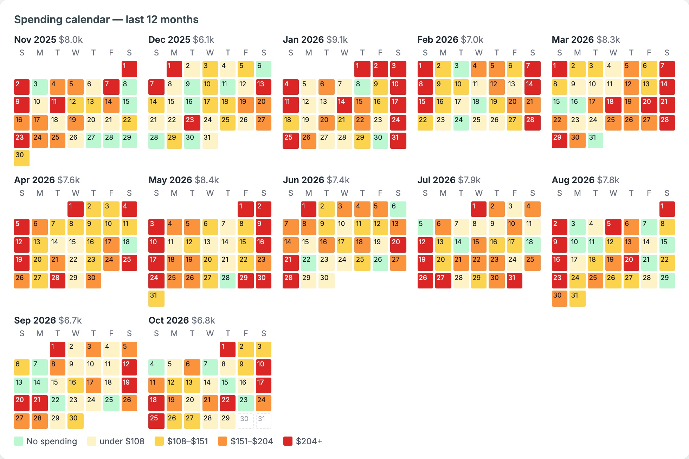

**Click any day** to open a drill-down donut for that single day. It goes
from groups to categories, then merchants, then the individual transactions.

### Spending breakdown donut

`{{ACTUALMINT:spending-breakdown-donut:[]}}`

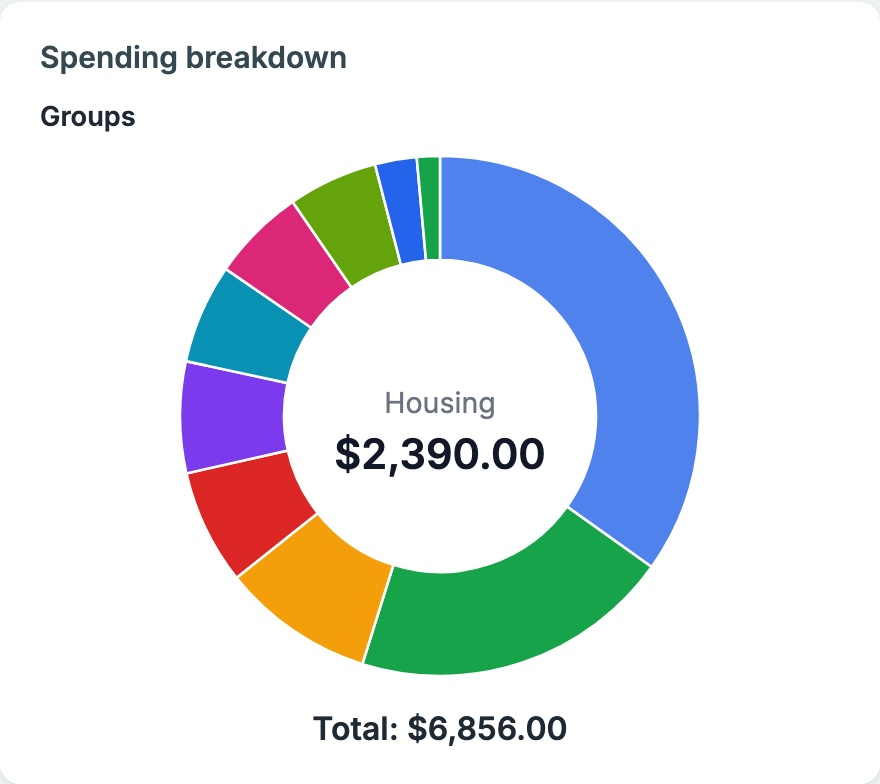

This month's spending by group. Hover a slice to see its name and amount in
the center, and click it to drill into categories, then merchants, then
transactions.
Pass a list of group ids to limit it to just those groups, for example
`["groupId1","groupId2"]`.

### Burn rate

`{{ACTUALMINT:burn-rate:null}}`

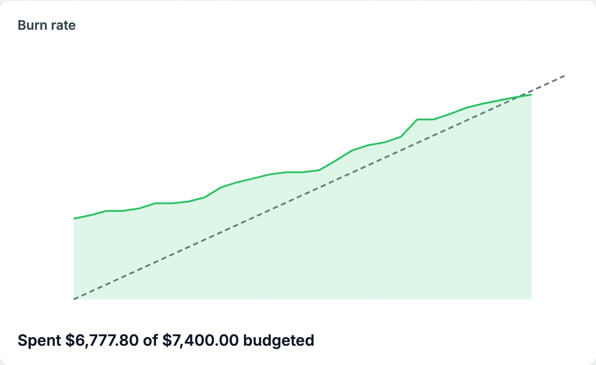

Cumulative spending through the month, plotted against a straight dashed
"on pace" line from $0 to your total budget. Above the line means you're
spending faster than the budget allows; below it means you're ahead. The
footer shows spent versus budgeted so far.

### Net savings rate gauge

`{{ACTUALMINT:savings-rate-gauge:[]}}`

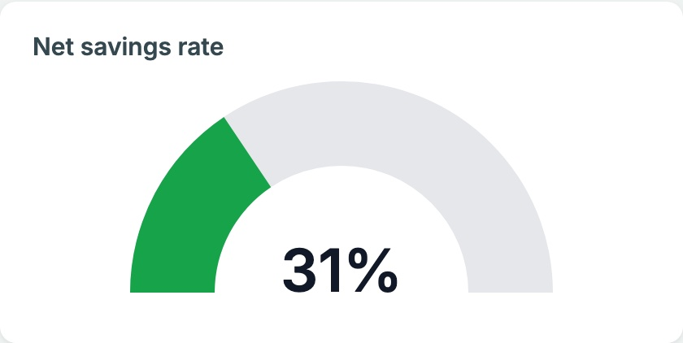

The share of this month's income you didn't spend:

`(income − spending + money moved to savings groups) ÷ income`

Red means negative (you spent more than you earned), amber 0–20%, and green
20% or more.

Some spending is really saving, like brokerage or 529 contributions. List
those category groups in the placeholder (`["groupId"]`, or tick them in the
widget builder) and they're added back as savings instead of counted as
spending.

### Sinking-fund goal thermometers

`{{ACTUALMINT:savings-goals-thermometers:[]}}`

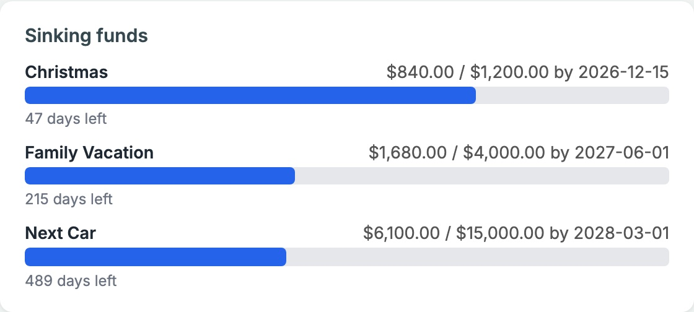

One bar per savings goal on a budget category (Christmas, vacation, next
car, …). Each shows the category's current balance against its target, the
target date, and the days left. Goals are set in the ActualMint settings card
(see [Savings goals](#savings-goals)). Pass category ids to show only some of
them.

### Account balances with a goal corridor

`{{ACTUALMINT:account-balances:[]}}`, or
`{{ACTUALMINT:account-balances:{"accountIds":[],"labelContent":"amount"}}}`

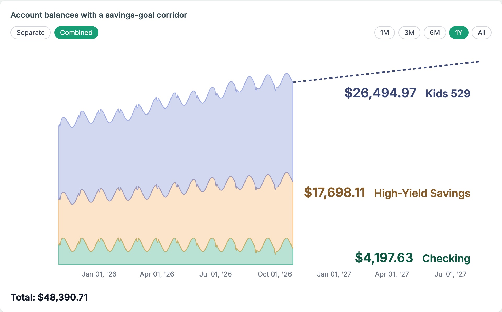

A stacked-area history of your account balances. There's a **Combined**
view, and a **Separate** view with one chart per account. Ranges are 1M, 3M,
6M, 1Y, and All.

When an account has a savings goal, like a kid's 529 with a target by
graduation, the 1Y and All views extend the timeline to the goal's target
date. A dashed line shows the path needed to reach it. `labelContent` picks
what each band's label shows: `"both"` (the default), `"amount"`, or
`"name"`.

### Subscription & bill radar

`{{ACTUALMINT:subscription-radar:null}}`

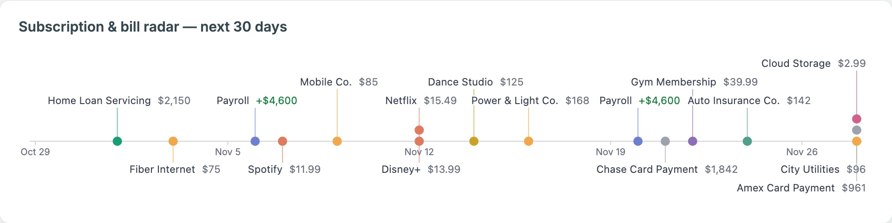

Every scheduled transaction in the next 30 days, laid out on a timeline:

- **Labels:** each one goes in the nearest free row above or below the line,
  so none ever overlap. Dots for the same day stack.
- **Amounts:** deposits show a green **+**.
- **Colors:** dots are colored by category group. Gray means the schedule has
  no category, which is common for credit-card payments since Actual treats
  them as transfers.

It reads straight from Actual's Schedules.

### How the charts count income and spending

The charts share one set of rules, so the Sankey, gauge, calendar, and
treemap always agree with each other:

- **Transfers:** moves between your own accounts never count as income or
  spending. That covers linked transfers, and also a category group named
  **Transfers**, for money moved between accounts but categorized rather
  than linked.
- **Income:** Actual's own income group counts, plus any category group with
  "Income" in its name, for budgets that keep paychecks in a regular group.
- **Starting balances:** opening balances from adding an account never count
  as income.
- **Refunds:** a category whose refunds outweigh its spending for the period
  is left out rather than drawn as negative spending.

## Savings goals

The two goal-based charts (the thermometers and the balance-history goal
line) read from **savings goals** you set in a new **ActualMint** card on
Actual's Settings page:

- **What a goal tracks:** either a budget category (a sinking fund) or an
  account (for example, a 529).
- **What a goal includes:** a target amount and a target date.
- **Where goals are stored:** in `goals.json` under
  `ACTUALMINT_DATA_DIR`. Mount a volume there; see
  [Configuration](#configuration).

## Other features

- **Budget pacing bars:** spent versus budgeted for any set of categories
  this month, at a glance. Click a bar to drill into categories, then payees,
  then transactions.
- **Projected month-end net:** where this month's balance is headed if the
  current pace holds.
- **Paycheck alerts:** flags 3-paycheck months for whichever pay cadence
  your income already shows. The cadence is detected, not hard-coded to
  biweekly.
- **Bills / autopay timeline:** a list of upcoming scheduled payments, with
  Actual's own Schedules as the source of truth.
- **Unlinked transfers:** pairs of matching inflows and outflows between
  your accounts that were never linked as a transfer. These double-count as
  income and spending until you link them.
- **Widget builder:** generates the exact placeholder string for any widget.
  Pick the type, check off categories, accounts, or groups, and copy the
  result, so you never hand-write one. It lives next to Actual's own "Add new
  widget" button on the Reports toolbar.
- **Mint-style theme:** a one-click re-skin of Actual's own color palette
  (Budget, Transactions, and Reports alike) into a light, airy teal-and-white
  look reminiscent of Mint.com.
  - **Where it's set:** from the "ActualMint" card on Actual's Settings page,
    saved per browser.
  - **Tip:** pick Actual's own **Light** theme first, since the recolor
    assumes a light background.
- **Global text-size control:** set from the same settings card. It scales
  the *entire* app (budget tables, transaction registers, reports,
  schedules), not just ActualMint's widgets. It's saved per browser.

| Pacing bars and drill-down | Reports widgets |
| --- | --- |
| 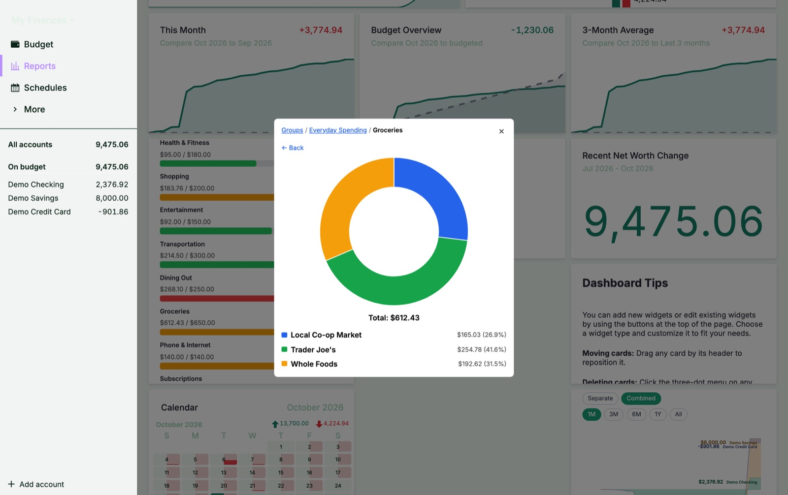 |  |

| Widget builder | Settings |
| --- | --- |
| 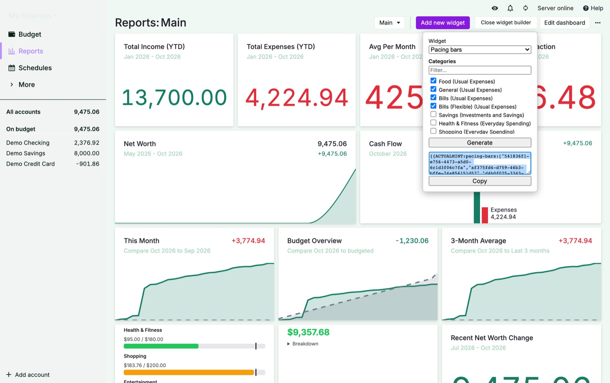 | 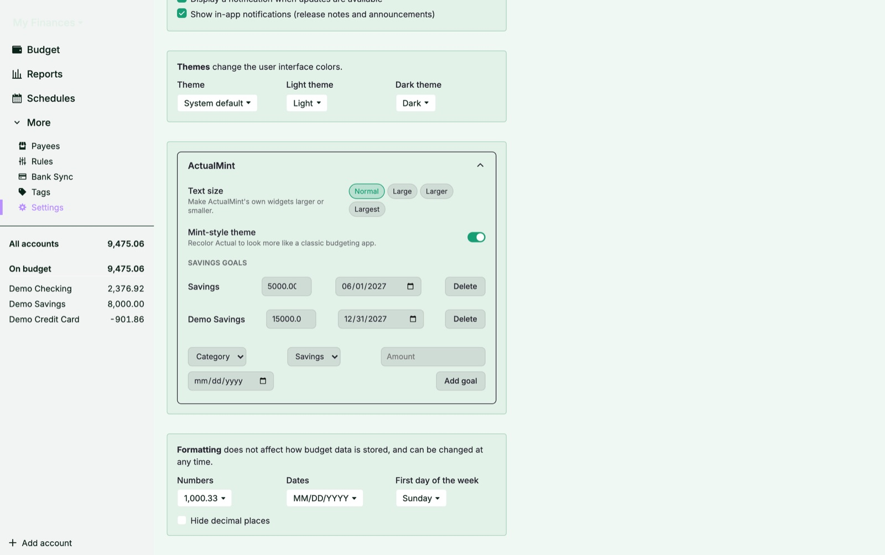 |

| Text size control |
| --- |
|  |

## Architecture

```
browser --(HTTPS)--> actualmint-proxy --> abt/actual (Actual's own server)
                           |
                           `--(/api/*)--> actualmint-api --> actual (direct)
```

- **`proxy/`** (`actualmint-proxy`): a reverse proxy in front of Actual, or
  in front of an [Actual Budget Tweaks](https://github.com/aelxxs/actual-budget-tweaks)
  sidecar if you run one. It passes everything through unchanged, except
  that it:
  - injects the bundle's `<script>`/`<link>` tags into HTML responses,
  - serves the bundle's static files,
  - proxies `/api/*` to `actualmint-api`.
- **`api/`** (`actualmint-api`): a small Express API backed by a single
  long-running [`@actual-app/api`](https://actualbudget.org/docs/api/)
  client connection. It's read-only, except for savings goals. Every request
  is validated against Actual's own session token, the same mechanism
  Actual's web client uses, so there's no separate login or credential to
  manage.
- **`bundle/`**: the browser-side code. That's the Svelte 5 + D3 widgets, the
  widget registry and builder panel, the settings card, and the mount logic
  that scans the page for `{{ACTUALMINT:...}}` placeholders.

## Configuration

### `actualmint-proxy`

| Env var | Default | Purpose |
| --- | --- | --- |
| `ABT_ORIGIN` | `http://abt:3005` | Upstream origin to proxy to (Actual, or an ABT sidecar in front of it) |
| `ACTUALMINT_API_ORIGIN` | `http://actualmint-api:3011` | Where `/api/*` requests are forwarded |
| `PORT` | `3010` | Port the proxy listens on |
| `ACTUALMINT_BUNDLE_PATH` | `/actualmint` | URL path prefix the bundle is served under |
| `STATIC_DIR` | `./static` | Filesystem directory served under `ACTUALMINT_BUNDLE_PATH` (the bundle's build output) |

### `actualmint-api`

| Env var | Purpose |
| --- | --- |
| `ACTUAL_SERVER_URL` | Your Actual server's own URL, e.g. `http://actual:5006` |
| `ACTUAL_SERVER_PASSWORD` | Actual's server password |
| `ACTUAL_SYNC_ID` | The budget's sync *group* id (Settings → Advanced Settings → Sync ID in Actual) |
| `ACTUAL_E2E_PASSWORD` | Only needed if the budget has end-to-end encryption enabled |
| `ACTUALMINT_DATA_DIR` | Where `goals.json` is stored (default `/data`). Mount a volume here so goals survive container rebuilds |
| `PORT` | `3011` by default |
| `TZ` | Set this to your own timezone, since several widgets do day-of-month math |

## Development

Each package is independent and has its own test suite:

```sh
cd bundle && npm install && npm test   # Svelte widgets, vitest
cd api && npm install && npm test      # actualmint-api, jest
cd proxy && npm install && npm test    # actualmint-proxy, jest
```

The bundle is a Vite build (`cd bundle && npx vite build`) that produces
`dist/bundle.js` and `dist/bundle.css`. `actualmint-proxy` serves those as a
read-only volume mount, so rebuilding the bundle never requires rebuilding or
restarting the proxy or API containers.

One gotcha for anyone writing new queries: Actual's AQL silently applies only
the **first** operator when a field has two, so `date: { $gte: a, $lte: b }`
means only "on or after `a`". Build date ranges with `dateRange()` in
`api/src/aql-date-range.js`, which uses `$and` instead.

## Adding a widget to a Reports page

1. Open the **Widget builder** panel on any Reports page.
2. Pick a widget type, and fill in any fields (categories, accounts, groups).
3. Click **Generate**.
4. Paste the resulting placeholder into a new Actual "Text widget" on your
   Reports dashboard.

## License

[MIT](LICENSE)
